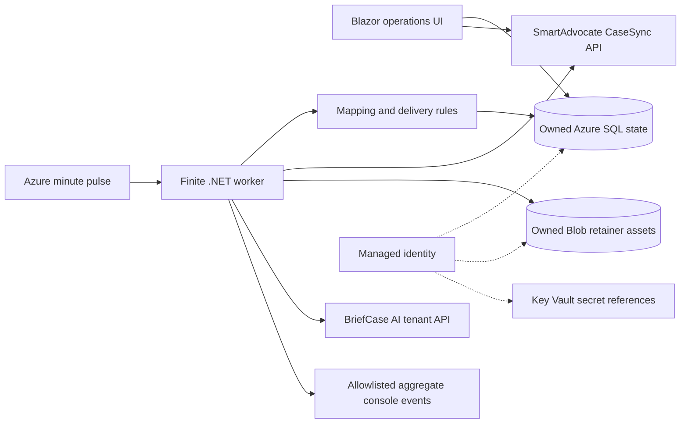

# Architecture decision: standalone scheduled sync

Status: implemented locally; development prerequisites partially provisioned November 9, 2026; hosting and tenant acceptance pending. See [development deployment inventory](development-deployment.md).

## Standards and service discovery

Reviewed the sibling `MassTortArchitecture` README, overview, pattern catalog, development, hosting, integration, data, identity, observability and infrastructure guidance. Its finite-work pattern supports Container Apps Jobs; the worker remains finite. The operations UI is a separate Blazor Container App with Entra authentication, persistent protected cookie keys and no destination-write credentials. See [UI architecture and acceptance](ui.md). .NET 10 is the supported LTS runtime selected for the new application. [Runtime policy](https://dotnet.microsoft.com/en-us/platform/support/policy/dotnet-core), [job behavior](https://learn.microsoft.com/en-us/azure/container-apps/jobs).

The sibling `mt-software-catalog` currently contains its README/metadata contract and no published service inventory, service registry, validator or publisher. No existing reusable vendor-integration service could be identified from that catalog. `service.yml` is proposed registration metadata; its owner, repository URL and canonical registry identifiers must be resolved when catalog registration becomes available. No existing Azure deployments or grants are inferred from illustrative architecture examples.

## Boundaries

Core contains business decisions and small adapter contracts. Infrastructure owns vendor HTTP/authentication, paging, SQL persistence, encryption, immutable file staging and the upload protocol. The worker runs once and exits. Azure supplies an every-minute wake-up pulse; versioned settings in SQL determine the business UTC schedule. UI and worker share these settings and the mapping rules. There is no message broker or outbox publisher because this application dispatches its own durable intent directly; every vendor write is preceded by a committed intent. Blob staging precedes the SQL reference; a crash between them can leave an unreferenced asset, which is safe but requires later protected cleanup.

## Ownership and consistency

Each environment uses a dedicated application resource group. `infra/main.bicep` owns its runtime identity, optional environment, logging workspace, storage, container and job. `infra/database.bicep` creates only the application's database on an explicitly referenced shared server; the server remains externally owned. The SQL project is the only schema publisher. Entra-contained SQL user permissions, Key Vault/ACR grants and network connectivity are separate deployment steps.

The database stores one AES-GCM encrypted state envelope per immutable source case. Its unique HMAC Tiger ID claim prevents two cases in the same scope from claiming the same external key. A session-owned SQL lock serializes all work in that scope, including HTTP effects; commands use the same connection and transparent reconnect is disabled. Scope must remain stable, with exactly one scope per source/destination pair. Independent applications/scopes can still collide at the vendor; the API's uniqueness rule remains authoritative. Do not run two distinct scopes for the same pair or use a new scope as a replay mechanism.

The intake payload, mapping version and fingerprint are frozen before HTTP. The PDF explicitly guarantees duplicate `leadVendorId` creates return the existing intake ID, permitting same-ID replay after an uncertain response. Only documented HTTP 400 validation responses release the frozen request for source correction. Unexpected failures retain it. A changed Tiger ID is an identity conflict. Existing intake corrections are retained as `UpdateRequired` because the API has no documented update operation.

Document sessions freeze source document identity, content checksum and the complete upload initialization request, including required BriefCase `documentType`. Core resolves the source document's literal `docType` using versioned configurable mappings; missing or unmapped values have no fallback. Saved mapping edits never rewrite pending requests or retag acknowledged content. Files are limited to 1–104857600 bytes; `.doc` is excluded. Restart calls idempotent completion first, reuses a valid incomplete session, and creates a replacement only when completion definitively reports missing bytes and the previous session is expired. Unknown initialization never causes a fresh initialization automatically. Multiple versions of one document are handled in sequence; unresolved prior work blocks newer uploads. Completion must return both expected IDs.

SmartAdvocate reads are not an atomic cross-endpoint snapshot. Discovery has no incremental checkpoint: each run performs a full eligible-status lookup and then revisits durable cases, so contact/UDF-only edits and late documents are not lost through a case-modified watermark. All UDF/document pages must finish, duplicate answer/document IDs/pages are rejected, and reported totals are checked. Case UDF responses include definition-only metadata that can recur on later pages. Metadata is excluded from answer identity/progress checks; a page without case-owned answers ends the answer stream. Definitions never become case values or prove that later answer pages have been read. Production capacity and live source selection/pagination semantics require acceptance in the actual tenant.

## Security, health and limits

Use managed identity for Azure SQL and Blob, and Key Vault for unavoidable vendor credentials and the state key. API and signed-storage clients are separate, redirects are disabled, and storage never receives API bearer credentials. Tenant URLs are server-owned configuration. SQL envelopes protect request data, identifiers, document names and signed session URLs; Blob encryption is provided by Azure Storage. Preserve the state key and both stores in coordinated recovery.

Operational output is deliberately limited to fixed events and aggregate counts; raw exceptions, HTTP bodies/URLs, names, filenames, SQL text and identifiers are not automatically exported. Container console collection supplies Log Analytics. `sync.Health` exposes aggregate durable state by status; no sampled diagnostic event is treated as authoritative delivery audit. Protected reconciliation records are stored inside the encrypted state. Configure resource diagnostics, alerts and operator access during deployment; no working alert delivery is claimed by these templates.

The current worker scans all retained cases and downloads eligible current retainer bytes to check content identity. This favors reliable change detection while vendor revision semantics are unverified. Validate batch size, memory, elapsed time and API limits before a large rollout. Run timeout is configurable (default 50 minutes); the job timeout is 60 minutes. SQL state ordering gives oldest-touched cases priority on the next run after interruption.

No production recovery objectives, retention policy, private-network posture or vendor capability acceptance are invented here. Those are environment-specific release inputs in the runbook.
